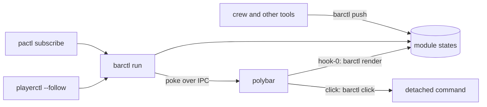

# Architecture Internals

How desktop-tools works inside: for contributors, reviewers and AI assistants. User-facing behaviour belongs on the other pages.

## Overview

One package, `desktop_tools`; each tool a sub-package with a console command; the shared pieces in `common/`. barctl
is the only program that talks to polybar.

## Components

| Module | Responsibility |
|---|---|
| `desktop_tools/__init__.py` | Package version (read lazily: the bar's hook imports the package) |
| `desktop_tools/config.py` | Settings and their precedence (`_FILE` > env > file > default) |
| `desktop_tools/cli.py` | The `desktop-tools` command (Typer): mounts each tool, writes completions |
| `desktop_tools/completions.py` | zsh completions generated from the Typer trees |
| `common/paths.py` | XDG folders |
| `common/journal.py` | The journal helper, copied from the brain (record 0017) |
| `common/theme.py` | The theme's roles from the generated `theme.zsh` |
| `common/polybar.py` | polybar's IPC protocol, `polybar-msg` fallback, finding, restarting and starting bars |
| `common/procs.py` | Running programs: a query, a followed stream, a detached launch, dropping inherited pipes |
| `barctl/cli.py` | `barctl`: the fast path for `render` and `push`, then the Typer app with run records |
| `barctl/fast.py` | `render` and `push`, standard library only |
| `barctl/app.py` | The Typer app: every verb |
| `barctl/ops.py` | What the verbs do |
| `barctl/modules.py`, `modules.toml` | The modules' config, and the packaged default |
| `barctl/state.py` | The state model and where states and settings live |
| `barctl/store.py` | Writing a state; poking only when what shows changed |
| `barctl/render.py` | A state as polybar text: colour, escaping, action tags, blink, segments, and the capsule (its scroll offset and progress cells worked out from the state and the time; `next_change` for the controller's tick) |
| `barctl/art.py` | The capsule's art accent: the cover fetched once (curl, HTTPS only, 2 s, 1 MiB) into a 20-file cache in the runtime folder, its average colour (magick), dropped under 3:1 against the theme's `bg` |
| `barctl/control.py` | The control socket's client |
| `barctl/controller.py` | `barctl run`: sources, control socket (with `pin`), alert and ttl timers, and the capsule timer: it pokes a capsule when its frame changes and sleeps until the next scroll step or progress cell |
| `barctl/doctor.py` | `barctl doctor`'s checks |
| `barctl/sources/` | The controller's sources: `volume`, `player` (the label `Artist – Title` whole; `progress` from `mpris:length` and `playerctl -p <shown> position`, read on the shown player's events and every 30 s while it plays; the in-memory pin; the art URL) |
| `barmenu/menus.py`, `menus.toml` | Menus as data, rofi placement, current rows as rofi's active rows, the detached launch |
| `barmenu/providers/` | Menus whose rows come from Python when they open (`theme`, `lock`, `tessera`), from read-only queries with a 2 s limit; state-free rows when a query fails (records 0001 and 0002). `tessera` reads only `tessera status --json`, never an entry name, and passes COORDINATOR, CLAUDECODE and TESSERA_ACTOR to tessera untouched |
| `barctl/modules.py` `Module.glyph_for` | The one place that decides a module's glyph (override, pushed, default), used by `render`, `store.shown`, `ops.module_info` and the menu prompt (record 0002 §7) |
| `barmenu/cli.py` | `barmenu`: a subcommand per menu, `run`, `list` |
| `crew/cli.py`, `crew/fast.py` | `crew`: the fast path for `status` and `bar`, then the Typer app (`crew/app.py`) with run records |
| `crew/registry.py` | The coordinators from `meta brain coordinators --json`, its kept copy, or the homes; former names; menu keys |
| `crew/switch.py` | Show, hide, toggle, cycle, width, side, list, stopped; `launch()`, a show's start through `meta <name> launch` |
| `crew/life.py` | `crew launch`, `stop`, `restart` and `stop --all`: each only through `meta <name> launch\|stop\|restart` |
| `crew/metacall.py` | The one way crew runs a lifecycle verb: `meta <name> <verb>`, its exit code and one-line reason |
| `crew/wm.py` | bspwm: one `bspc wm -d` per look; placing the panel and reserving its strip |
| `crew/tmux.py` | Which sessions exist, on the server `CREW_TMUX_SOCKET` names |
| `crew/strip.py` | The bar strip: running, shown and activity per coordinator, pushed to barctl's `crew` module |
| `crew/menus.py` | `crew quick` (one coordinator's menu, from meta's items) and `crew menu` (the two-level menu) |
| `crew/items.py` | meta's menu items: parsing, `when`, running each kind (`meta`, `open`, `edit`, `copy`) and each output |
| `crew/stopping.py` | The menus' Launch, Stop and Restart on `life` and `metacall`, with the Yes/No questions (the brain always asked); Stop all is `life.stop_all` |
| `crew/hook.py` | `crew status`, the Claude hook: event to state, standard library only |
| `crew/guard.py` | `crew guard`: bspwm's events, the settle deadline, the drag hold-off, the re-dock |
| `crew/store.py`, `crew/conf.py`, `crew/log.py`, `crew/out.py` | crew's files and locks, settings, messages and stdout |

## Data flow

A volume change: `pactl subscribe` prints `Event 'change' on sink #57`; the volume source re-reads the default sink and
writes `audio-level`'s state (`$XDG_RUNTIME_DIR/barctl/modules/audio-level.json`, written whole and renamed into
place). If what it shows changed, barctl sends `#audio-level.hook.0` to every bar's socket; polybar runs
`barctl render audio-level`, which reads the file and the theme's roles and prints the coloured text in its action tags.

- **State** lives in the runtime folder, emptied at logout, so yesterday's state can't show. Settings (disabled
  modules) live in `$XDG_STATE_HOME/desktop-tools/barctl/`; the zsh controller's `~/.local/state/barctl` is left alone
  for a rollback.
- **A push** writes the file itself, then tells the controller over `control.sock` (one second at most); with no
  controller it pokes the module itself. Blinks and ttl expiry need the controller.
- **A source's stream ends** (pipewire-pulse restarted): its modules go unavailable and it restarts after
  `BARCTL_RETRY` seconds. A source that keeps raising an unexpected exception stops the controller with exit 1, for
  systemd to restart it.
- **A polybar restart**: `initial = 1` runs each hook, which renders from the files; the controller is not involved.
- **The capsule** (design record 0003 §3): the player source writes `progress` (`position`, `length`, `rate`, `at`,
  `playing`) and the label once per real change; render works out the position and the scroll offset from the time,
  as it does the blink. `store.shown` leaves out `position` and `at`, so a re-read position pokes nothing; the
  controller's tick reads each capsule's state, pokes it when its frame (text cells, underlined cells) changed, and
  sleeps until the next change: at most `scroll` times a second while scrolling, at most once a second for progress
  alone, not at all while paused.
- **A pin** (`barctl pin <module> <instance>`) is a `pin` request on the control socket; the player source shows that
  player while `playerctl -l` lists it. `barctl status --json` gives the player modules `pinned`, from the
  controller's `ping` answer.
- **A click** runs `barctl click`, which starts the configured command in its own session with no inherited
  descriptors: polybar 3.7 leaks its module pipes into children, and a long-lived holder can freeze its next restart.

A coordinator's turn: Claude runs its hook, `crew status`, with the event's JSON on stdin. If the coordinator's state
changed (busy, say), crew writes `$XDG_RUNTIME_DIR/crew/state/<name>` and starts `crew bar --quiet` detached, so the
hook returns at once. That looks at bspwm and tmux once each, builds a segment per coordinator and pushes them to
barctl's `crew` module in-process (`barctl.ops.push`, with a time to live); barctl pokes the module and polybar runs
`barctl render crew`. A click on a glyph runs `barctl click crew left --segment <name>`, which runs
`crew toggle --launch <name>` detached; a right click runs `crew quick <name>` and a middle click `crew menu` the same
way. The quick menu asks `meta <name> menu --json` for its items each time it opens (meta caches it for 30 seconds).

## Design decisions

Why things are the way they are is recorded in [docs/design/](https://github.com/andronics/desktop-tools/tree/main/docs/design). Rejected ideas and the reasons are in [TODO.md](https://github.com/andronics/desktop-tools/blob/main/TODO.md) under "Decided against".

This repo has no design records of its own yet: barctl's design is the dotfiles' [record 0003](https://github.com/andronics/dotfiles/blob/main/docs/design/0003-desktop-tools-in-python.md) (Python,
one package, Typer with a standard-library fast path, barctl as polybar's only owner, the state model, the verbs),
which amends [record 0001](https://github.com/andronics/dotfiles/blob/main/docs/design/0001-polybar-ipc-module-taxonomy.md) (custom/ipc modules, one render hook, the colour tiers, the player rule, barmenu menus).
crew's is the brain's record 0019 (§4 the registry, §7 coord becoming crew, §7a the quick menu), with the brain coordinator's decision of
2026-11-04 that showing never starts a stopped coordinator; its strip follows record 0003 Part C.
