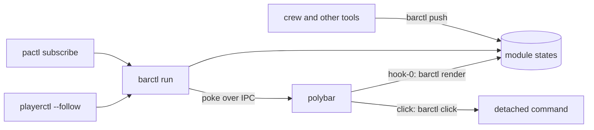

# Architecture Internals

How desktop-tools works inside: for contributors, reviewers and AI assistants. User-facing behaviour belongs on the other pages.

## Overview

One package, `desktop_tools`; each tool a sub-package with a console command; the shared pieces in `common/`. barctl
is the only program that talks to polybar.

## Components

| Module | Responsibility |
|---|---|
| `desktop_tools/__init__.py` | Package version (read lazily: the bar's hook imports the package) |
| `desktop_tools/config.py` | Settings and their precedence (`_FILE` > env > file > default) |
| `desktop_tools/cli.py` | The `desktop-tools` command (Typer): mounts each tool, writes completions |
| `desktop_tools/completions.py` | zsh completions generated from the Typer trees |
| `common/paths.py` | XDG folders |
| `common/journal.py` | The journal helper, copied from the brain (record 0017) |
| `common/theme.py` | The theme's roles from the generated `theme.zsh` |
| `common/polybar.py` | polybar's IPC protocol, `polybar-msg` fallback, finding, restarting and starting bars |
| `common/procs.py` | Running programs: a query, a followed stream, a detached launch, dropping inherited pipes |
| `barctl/cli.py` | `barctl`: the fast path for `render` and `push`, then the Typer app with run records |
| `barctl/fast.py` | `render` and `push`, standard library only |
| `barctl/app.py` | The Typer app: every verb |
| `barctl/ops.py` | What the verbs do |
| `barctl/modules.py`, `modules.toml` | The modules' config, and the packaged default |
| `barctl/state.py` | The state model and where states and settings live |
| `barctl/store.py` | Writing a state; poking only when what shows changed |
| `barctl/render.py` | A state as polybar text: colour, escaping, action tags, blink, segments |
| `barctl/control.py` | The control socket's client |
| `barctl/controller.py` | `barctl run`: sources, control socket, alert and ttl timers |
| `barctl/doctor.py` | `barctl doctor`'s checks |
| `barctl/sources/` | The controller's sources: `volume`, `player` |
| `barmenu/menus.py`, `menus.toml` | Menus as data, rofi placement, the detached launch |
| `barmenu/cli.py` | `barmenu`: a subcommand per menu, `run`, `list` |

## Data flow

A volume change: `pactl subscribe` prints `Event 'change' on sink #57`; the volume source re-reads the default sink and
writes `audio-level`'s state (`$XDG_RUNTIME_DIR/barctl/modules/audio-level.json`, written whole and renamed into
place). If what it shows changed, barctl sends `#audio-level.hook.0` to every bar's socket; polybar runs
`barctl render audio-level`, which reads the file and the theme's roles and prints the coloured text in its action tags.

- **State** lives in the runtime folder, emptied at logout, so yesterday's state can't show. Settings (disabled
  modules) live in `$XDG_STATE_HOME/desktop-tools/barctl/`; the zsh controller's `~/.local/state/barctl` is left alone
  for a rollback.
- **A push** writes the file itself, then tells the controller over `control.sock` (one second at most); with no
  controller it pokes the module itself. Blinks and ttl expiry need the controller.
- **A source's stream ends** (pipewire-pulse restarted): its modules go unavailable and it restarts after
  `BARCTL_RETRY` seconds. A source that keeps raising an unexpected exception stops the controller with exit 1, for
  systemd to restart it.
- **A polybar restart**: `initial = 1` runs each hook, which renders from the files; the controller is not involved.
- **A click** runs `barctl click`, which starts the configured command in its own session with no inherited
  descriptors: polybar 3.7 leaks its module pipes into children, and a long-lived holder can freeze its next restart.

## Design decisions

Why things are the way they are is recorded in [docs/design/](https://github.com/andronics/desktop-tools/tree/main/docs/design). Rejected ideas and the reasons are in [TODO.md](https://github.com/andronics/desktop-tools/blob/main/TODO.md) under "Decided against".

This repo has no design records of its own yet: barctl's design is the dotfiles' [record 0003](https://github.com/andronics/dotfiles/blob/main/docs/design/0003-desktop-tools-in-python.md) (Python,
one package, Typer with a standard-library fast path, barctl as polybar's only owner, the state model, the verbs),
which amends [record 0001](https://github.com/andronics/dotfiles/blob/main/docs/design/0001-polybar-ipc-module-taxonomy.md) (custom/ipc modules, one render hook, the colour tiers, the player rule, barmenu menus).
